<p align="center"></p>

<p align="center">


</p>

<p align="center"></p>

<p align="center"></p>

<p align="center">
<a href="https://github.com/Baltore/tvtrack"></a>
<a href="https://github.com/Baltore/Domotique-HomeASS"></a>
</p>

## `> skill map`

<p align="center"></p>

## `> development`

<p>


</p>
<p>


</p>

<p>


</p>

## `> currently`

```text
▸ deepening detection engineering and log analysis (SIEM)
▸ building more secure, container-based deployments
▸ evolving my smart-home / 3D dashboard project
```

<p align="center"><sub>Looking at my repositories? Everything public here is audited for secrets and personal data.</sub></p>
